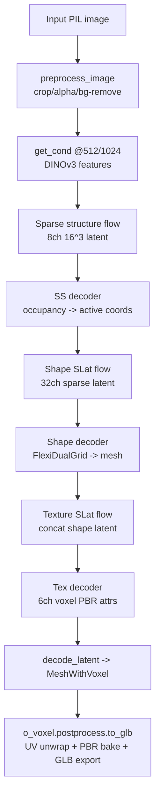

# TRELLIS.2 Architecture Map (Fork Baseline)

This map is derived from the checked-out source in this repository plus referenced HF pipeline/checkpoint configs.

## 1) End-to-end image->3D pipeline (actual code path)

Primary runtime entry:

- `trellis2/pipelines/trellis2_image_to_3d.py`
- Class: `Trellis2ImageTo3DPipeline`
- Method: `run(...)`

## 2) Stage-by-stage implementation details

| Stage | File + function/class | Inputs -> outputs (with readable shapes) | Checkpoints loaded | CUDA/extension dependencies |
|---|---|---|---|---|
| Image preprocessing / background removal | `trellis2/pipelines/trellis2_image_to_3d.py::preprocess_image` | `PIL.Image` -> cropped RGB foreground image (`<=1024` max side). If RGBA alpha exists and not all 255, uses alpha directly; otherwise calls `self.rembg_model(...)`. | `rembg_model` from HF `pipeline.json` (currently `briaai/RMBG-2.0` via `BiRefNet` wrapper) | PyTorch + Transformers runtime; no repo-local CUDA extension required at this stage |
| Conditioning | `...::get_cond` with `image_feature_extractor.DinoV3FeatureExtractor` | image list/tensor -> `cond` tensor (feature dim 1024 from config); optional `neg_cond = zeros_like(cond)` | `image_cond_model` from HF `pipeline.json`: `facebook/dinov3-vitl16-pretrain-lvd1689m` | PyTorch/Transformers; no repo-local CUDA extension |
| Sparse structure stage | `...::sample_sparse_structure` | Noise tensor `torch.randn(B,8,16,16,16)` (from `ss_flow...json`) -> denoised latent -> decoded occupancy -> active `coords` (`torch.argwhere`, shape `[T,4]` batch+xyz). For 512/cascade, occupancy is pooled from decoder output to target 32 grid. | Flow: `ckpts/ss_flow_img_dit_1_3B_64_bf16`; decoder: `microsoft/TRELLIS-image-large/ckpts/ss_dec_conv3d_16l8_fp16` | Attention backend (`flash_attn`/`xformers`/etc) for flow blocks; decoder uses dense torch convs |
| Shape SLat stage | `...::sample_shape_slat` and `...::sample_shape_slat_cascade` | Sparse noise `SparseTensor(feats=[T,32], coords=[T,4])` -> shape latent `SparseTensor(feats=[T,32])`; cascade path upsamples coords and may reduce HR resolution if `max_num_tokens` exceeded | `ckpts/slat_flow_img2shape_dit_1_3B_512_bf16`, `..._1024_bf16`; normalization arrays from pipeline config | Sparse attention backend + sparse conv backend (default `flex_gemm`; configurable `spconv`/`torchsparse`) |
| O-Voxel geometry extraction | `trellis2/models/sc_vaes/fdg_vae.py::FlexiDualGridVaeDecoder.forward` | Shape latent -> predicted dual-grid vertex offsets/intersection flags -> mesh via `o_voxel.convert.flexible_dual_grid_to_mesh(...)` | `ckpts/shape_dec_next_dc_f16c32_fp16` | **`o_voxel` CUDA extension** (`o_voxel._C`) + sparse backend |
| Texture SLat stage | `trellis2/pipelines/trellis2_image_to_3d.py::sample_tex_slat` | Concatenates normalized shape latent with noise (`in_channels=64`, `out_channels=32` from `slat_flow_imgshape2tex...json`) -> texture latent | `ckpts/slat_flow_imgshape2tex_dit_1_3B_512_bf16`, `..._1024_bf16`; normalization arrays from pipeline config | Sparse attention backend + sparse conv backend |
| Material decoding | `...::decode_tex_slat` -> `self.models['tex_slat_decoder'](slat) * 0.5 + 0.5` | Texture latent -> sparse voxel attributes `feats[:, 0:6]` mapped as base_color(3), metallic(1), roughness(1), alpha(1) | `ckpts/tex_dec_next_dc_f16c32_fp16` | Sparse backend (`flex_gemm`/`spconv`/`torchsparse`) |
| Mesh assembly | `...::decode_latent` | Combines shape mesh + tex voxel attrs -> `MeshWithVoxel(vertices, faces, coords, attrs, voxel_size, layout)` | n/a (uses outputs above) | None beyond prior stage outputs |
| Mesh postprocess + GLB export | `o-voxel/o_voxel/postprocess.py::to_glb` (used in `app.py` / `example.py`) | `vertices/faces + sparse attr volume` -> cleaned/remeshed/UV-unwrapped textured `trimesh.Trimesh` -> `.export(..., extension_webp=True)` | n/a | **`cumesh`**, **`nvdiffrast`**, **`flex_gemm`** (grid sampling), OpenCV inpainting |

## 3) Checkpoint wiring (from HF configs actually referenced)

HF config files inspected:

- `microsoft/TRELLIS.2-4B/pipeline.json`
- `microsoft/TRELLIS.2-4B/texturing_pipeline.json`

Loaded model keys in image->3D pipeline:

- `sparse_structure_flow_model` -> `ckpts/ss_flow_img_dit_1_3B_64_bf16`
- `sparse_structure_decoder` -> `microsoft/TRELLIS-image-large/ckpts/ss_dec_conv3d_16l8_fp16`
- `shape_slat_flow_model_512` -> `ckpts/slat_flow_img2shape_dit_1_3B_512_bf16`
- `shape_slat_flow_model_1024` -> `ckpts/slat_flow_img2shape_dit_1_3B_1024_bf16`
- `shape_slat_decoder` -> `ckpts/shape_dec_next_dc_f16c32_fp16`
- `tex_slat_flow_model_512` -> `ckpts/slat_flow_imgshape2tex_dit_1_3B_512_bf16`
- `tex_slat_flow_model_1024` -> `ckpts/slat_flow_imgshape2tex_dit_1_3B_1024_bf16`
- `tex_slat_decoder` -> `ckpts/tex_dec_next_dc_f16c32_fp16`
- conditioning model -> `facebook/dinov3-vitl16-pretrain-lvd1689m`
- rembg model -> `briaai/RMBG-2.0`

Texturing pipeline (`Trellis2TexturingPipeline`) additionally loads:

- `shape_slat_encoder` -> `ckpts/shape_enc_next_dc_f16c32_fp16`

## 4) Training and data_toolkit mapping

### Training entrypoint

- `train.py`
  - Loads JSON config (`--config`)
  - Instantiates dataset from `trellis2/datasets/*`
  - Instantiates models from `trellis2/models/*`
  - Runs trainer from `trellis2/trainers/*`

### Main config families in repo

- `configs/scvae/*.json`
  - shape VAE (`FlexiDualGridVaeEncoder/Decoder`)
  - texture VAE (`SparseUnetVaeEncoder/Decoder`)
- `configs/gen/*.json`
  - sparse-structure flow
  - shape SLat flow
  - texture SLat flow

### Data preparation pipeline (scripts actually present)

- Metadata/download: `data_toolkit/build_metadata.py`, `download.py`
- Mesh/PBR dumps: `dump_mesh.py`, `dump_pbr.py`, `asset_stats.py`
- O-Voxel conversion: `dual_grid.py`, `voxelize_pbr.py`
- Latent encoding: `encode_shape_latent.py`, `encode_pbr_latent.py`, `encode_ss_latent.py`
- Conditional renders: `render_cond.py` (Blender-driven)

Default pretrained encoders in data toolkit:

- Shape latent encoder: `microsoft/TRELLIS.2-4B/ckpts/shape_enc_next_dc_f16c32_fp16`
- PBR latent encoder: `microsoft/TRELLIS.2-4B/ckpts/tex_enc_next_dc_f16c32_fp16`
- Sparse-structure encoder: `microsoft/TRELLIS-image-large/ckpts/ss_enc_conv3d_16l8_fp16`
